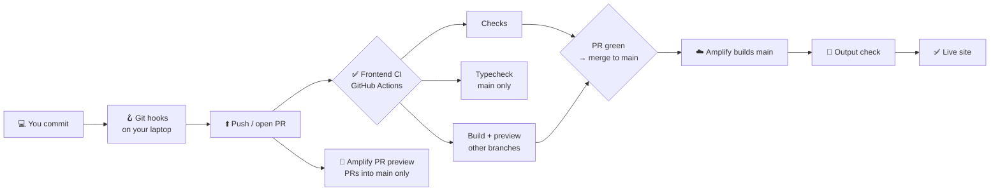

# CI/CD — how frontend code gets from your laptop to the live website

This page explains every automatic check and step the frontend goes through, **why each one exists**, and what to do when one goes red. No prior DevOps knowledge needed. (Backend twin: `../wisetech-backend/docs/CI_CD.md`.)

---

## The big idea, in one story 🎨

Think of the website as a **school art exhibition**, and every code change as a **new painting** you want to hang.

Before a painting goes on the wall where parents will see it:

1. **The teacher checks it** — no rude words hidden in the corner, colours not smudged, signed properly. *(Checks job)*
2. **Someone checks the frame fits** — the painting is the right size for the frame. *(Typecheck)*
3. **It's hung in a practice room first** — does it actually stay on the wall? Can you see it from the door? *(Build + preview, and the Amplify preview site)*
4. **Only then is it hung in the main hall**, exactly as approved. *(Amplify deploy)*
5. **The caretaker checks the wall isn't empty** before opening the doors. *(Amplify's output check)*

If **any** step fails, the painting doesn't go up — the old one stays.

- **CI** = *Continuous Integration* = "is this change safe?" — runs on **GitHub Actions**.
- **CD** = *Continuous Deployment* = "put it on the live site" — done by **AWS Amplify**.

They are two different services that both watch the same repository. GitHub *checks*; Amplify *builds and hosts*.

---

## The whole journey at a glance



| File | What it is |
|---|---|
| `.husky/*` | The checks on **your laptop** |
| `.github/workflows/ci.yml` | ✅ **Frontend CI** — the safety checks (GitHub) |
| `.github/actions/setup/action.yml` | Shared "get ready" step every CI job uses (pnpm + Node 24 + install) |
| `amplify.yml` | ☁️ **The deploy recipe** Amplify follows to build and publish the site |
| `scripts/verify-build-env.mjs` | Stops a deploy when a required setting (env variable) is missing |
| `.github/dependabot.yml` | A robot that opens PRs to update old packages every week |

> **Why are these files in three different places?** Each service only looks in one spot: GitHub reads workflows only from `.github/workflows/`, Dependabot only from `.github/dependabot.yml`, and Amplify only from `amplify.yml` at the repo root. Move any of them and it silently stops working.

---

## Stage 0 — Git hooks (on your laptop) 🪝

| When | What it checks | Time |
|---|---|---|
| `git commit` | No passwords/keys, no merge markers, no `debugger`, no file over 2 MB; ESLint on the files you staged | < 5s |
| commit message | Follows `feat(scope): what changed` | instant |
| `git push` | Not pushing straight to `main`/`master`/`develop`; typecheck + lint on files changed vs `main` | ~90s |

**🧒 Like:** checking your school bag at home so you don't arrive without your homework.

**But:** `--no-verify` skips them all. That's why CI repeats them — **CI is the check nobody can skip.**

---

## Stage 1 — Frontend CI ✅ (`ci.yml`, GitHub Actions)

### When does it run?

**Once per push, on any branch.** One push = one run. There is no separate pull-request run.

| You push to… | Jobs that run | Shows on the PR as |
|---|---|---|
| any branch except `main` (e.g. `dev`, `bill-development`) | **Checks** + **Build + preview** | `Frontend CI / Checks … (push)`, `Frontend CI / Build + preview (push)` |
| `main` | **Checks** + **Typecheck** | (Amplify then deploys) |

> **"How does my PR get its checks without a PR run?"**
> A pull request's checks list shows every check that ran on its **latest commit** — and your push already ran them. Branch protection looks for the check **names** on that commit, so the push run is enough. Each job appears **once**.
>
> **"Why does `main` get Typecheck instead of Build?"** Amplify builds `main` itself, so a CI bundle there would be a second one nobody uses. Typecheck is the quick safety net. Everywhere else, Build already includes the typecheck, so a separate Typecheck would be the same work twice.
>
> Pushing again while a run is going cancels the older run, so you never wait on stale results.

### The jobs run **at the same time**

Steps inside one job run one after another. Everything used to be one long job (~5 minutes, the **sum** of all steps). Now the jobs run side by side, so you wait only for the **slowest** one.

**🧒 Like:** three friends doing the dishes, sweeping and folding clothes at the same time, instead of one person doing all three in a row.

---

### Job: **Checks (scan, lint, tests, audit)** 🔍

| Step | What it does | Why it exists | 🧒 Kid version |
|---|---|---|---|
| 🧷 Guard self-test | Tests the secret-scanner itself | A broken scanner would wave everything through | Pressing the smoke alarm's test button |
| 🔐 Secret and hygiene scan | Checks **only the files you changed** for API keys, passwords, merge markers, `debugger`, `.only(`, files over 2 MB | Anything in the frontend ends up in every visitor's browser — a key here is a key given to the whole world | Making sure nobody wrote the house alarm code on the exhibition label |
| 🧹 Lint changed files | ESLint on the `.ts/.tsx` files you changed (not `src/_metronic/`) | Catches real bugs (broken React hooks, unsafe `?.`) and banned UI (native date inputs, hardcoded `₹`). Only *changed* files, because ~60 old files have known errors — new code must be clean, old code isn't a blocker | The teacher marks your new page, not the whole old notebook |
| 🧪 Run tests | `vitest run` — all the component/logic tests | Proves the pieces still behave | Tasting each ingredient |
| 🧩 Task-domain tests | The task-rules test file, which uses Node's own test runner | Written for a different runner; kept rather than rewriting 45 passing checks | Same tasting, different spoon |
| 🛡️ Audit dependencies | `pnpm audit` — fails on **high/critical** security holes in our packages | A hole in a package becomes a hole in our site | Checking none of the toys in the box have been recalled |

**Example failure:**
```
src/app/pages/billing/Foo.tsx
  12:5  error  React Hook "useState" is called conditionally  react-hooks/rules-of-hooks
```
➡️ Fix it locally (`pnpm exec eslint --quiet <file>`), push again.

> The audit only blocks on **real** advisories. If the npm server is unreachable, it shows a yellow warning and moves on.

---

### Job: **Typecheck** (`main` only) 🔎

Runs `tsc --noEmit` over all ~1,900 TypeScript files.

**Why only on `main`?** On every other branch, the Build job runs `pnpm run build`, which is `tsc && vite build` — the same typecheck is inside it. Running both was a big part of why CI used to take 5 minutes.

**🧒 Like:** measuring that the painting fits the frame. In the practice room, hanging it measures it anyway, so we don't measure twice.

**Example failure:** `error TS2322: Type 'string' is not assignable to type 'number'.` ➡️ Run `pnpm exec tsc --noEmit` locally, fix, push.

---

### Job: **Build + preview** 🏗️ (every branch except `main`)

| Step | What it does | Why |
|---|---|---|
| 🏗️ Build | `pnpm run build` — typecheck, then Vite bundles the site into `dist/` (needs a 4 GB memory heap) | A build can fail even when types are fine: a wrong import path, a missing image, a broken lazy-loaded page. TypeScript never looks at those — only the bundler does |
| 🌐 Preview route | Starts the built site locally and loads `/employees/create-new`, checking the page shell appears | Proves the bundle actually serves a page, not just that it compiled |

**Why not on `main`?** `main` is built by **Amplify** (that's the build that ships). Every other branch is on its way to `main`, and this build is the **last check before it gets there** — once merged, Amplify deploys straight away and nothing stops it. So the bundle is proven *here*, on the branch, before the merge.

It runs `pnpm run build` = typecheck **+** `pnpm run build:bundle`. Amplify runs **only** `build:bundle` — it trusts that this job already typechecked the code before it could merge. Both use the same `build:bundle` script, so "green in CI" means "will build on Amplify".

**🧒 Like:** hanging the painting in the practice room before the main hall — if it falls off there, it never goes up for parents.

---

## Stage 2 — AWS Amplify ☁️ (`amplify.yml`)

Amplify is a separate AWS service connected to this repository. It does two things:

### A) 👀 PR previews — every pull request into `main`

Shown on the PR as **"AWS Amplify Console Web Preview"**. Amplify builds the PR's code and hosts it at a temporary web address, so you can **click through the real change** before merging — great for checking UI and layout on a phone. The preview is deleted when the PR closes.

**🧒 Like:** a photo of the painting on the wall, sent to the teacher to approve before it's actually hung.

### B) 🚀 Production deploy — every push to `main`

**Only `main` deploys.** A push to `dev` never reaches users — `dev` is for testing together.

What Amplify does, in order:

| Phase | Step | Why |
|---|---|---|
| preBuild | `nvm install 24` | pnpm 11 needs Node ≥ 22.13; Amplify's default is older |
| preBuild | **`node scripts/verify-build-env.mjs`** | See below — runs *first*, takes seconds |
| preBuild | `corepack enable` + `pnpm install --frozen-lockfile` | Installs exactly the package versions the lockfile pins — the ones CI tested |
| build | `pnpm run build:bundle` — Vite bundle **only**, no typecheck | The typecheck already passed in CI before the merge, so repeating it here only cost time (~1 min on every preview and deploy). Safe because branch protection requires CI and up-to-date branches — remove that protection and this must go back to `pnpm run build` |
| postBuild | `dist/index.html` exists? `dist/assets/` not empty? | Never publish an empty site over a working one |
| deploy | Publishes `dist/` | The live site updates |

#### The env-variable check (`verify-build-env.mjs`) 🔑

Settings like the backend's address (`VITE_APP_WISE_TECH_BACKEND`) are **not in the repo** — they live in **Amplify → Hosting → Environment variables**. Vite bakes them into the site at build time.

The danger: if one is missing or misspelled, Vite **doesn't complain** — it puts in the word `undefined`, the build passes, the deploy goes green… and users get a **white screen** with every request going to `undefined/api/...`.

This script fails the deploy in seconds instead:
- **REQUIRED** missing (e.g. `VITE_APP_WISE_TECH_BACKEND`) ➡️ deploy **stops**.
- **RECOMMENDED** missing (e.g. the Google Maps key) ➡️ yellow warning; a map widget breaking is not worth blocking a release.

**🧒 Like:** checking the exhibition hall's address is written on the invitations *before* printing 500 of them.

#### Other bits in `amplify.yml`
- **Cache:** keeps pnpm's package store between builds, so installs are faster.
- **Rewrites:** sends every page URL (like `/project/123/billing`) to `index.html`, so refreshing a page doesn't show a 404. React then shows the right page.

---

## Dependabot 🤖 (`dependabot.yml`)

Every week, a GitHub robot checks for newer versions of our packages and of the GitHub Actions we use, and opens PRs:
- small updates (minor + patch) are **grouped into one PR**;
- big updates (major) come **one at a time**, because they can break things.

Each Dependabot PR goes through CI and gets an Amplify preview like any other PR.

**🧒 Like:** a librarian who replaces worn-out books before the pages fall out.

---

## "My check is red — what now?" 🚑

| Red check | Most likely cause | Do this |
|---|---|---|
| Checks → 🔐 Secret scan | Key/password/merge marker in a changed file | Remove it. If a real key was pushed, **rotate the key** — deleting the line doesn't un-leak it. For an intentional match, add `guard:allow` in a comment on that line |
| Checks → 🧹 Lint | A real-bug rule or banned UI pattern | `pnpm exec eslint --quiet <file>`; fix the code — don't add `eslint-disable` |
| Checks → 🧪 Tests | Your change broke a behaviour | `pnpm run test` locally |
| Checks → 🛡️ Audit | A package has a high/critical advisory | Update it, or pin a safe floor in `pnpm-workspace.yaml` → `overrides` |
| Typecheck | Type error | `pnpm exec tsc --noEmit` |
| Build + preview | Bundler error (bad import path, missing asset) or the page didn't load | `pnpm run build` locally and read the first error |
| Amplify → preBuild "missing env" | A required `VITE_` variable isn't set in the Amplify console | Add it in **Amplify → Hosting → Environment variables**, redeploy |
| Amplify → postBuild "dist missing/empty" | Build produced no output | Run `pnpm run build` locally and check `dist/` |

**When Amplify fails, the previous version stays live** — users don't see a broken site, they just don't get the new one yet.

---

## Rules that keep this safe 🔒

Set in **GitHub → Settings → Branches → `main`** (not in any file). These are what make "red can't reach production" true — Amplify itself deploys every push to `main` without looking at CI:

- ✅ **Require a pull request before merging**
- ✅ **Require status checks to pass** → `Checks (scan, lint, tests, audit)` and `Build + preview`
- ✅ **Require branches to be up to date before merging** — the PR's latest commit then already contains `main`, so the checks test exactly what will land.
- ✅ **Do not allow bypassing the above settings**

> Don't add `Typecheck` as a required check: it only runs on `main`, never on the branch a PR comes from, so requiring it would leave every PR waiting forever. (Build already typechecks.)

---

## Quick glossary 📖

| Word | Means |
|---|---|
| **Workflow** | One `.yml` file in `.github/workflows/` — a list of jobs GitHub runs |
| **Job** | A group of steps on one fresh virtual machine. Jobs can run in parallel |
| **Step** | One command inside a job. Steps in a job run in order |
| **Skipped** | The job's condition said "not needed on this branch" — not a failure |
| **PR** | Pull request — asking to merge one branch into another |
| **Amplify** | The AWS service that builds and hosts the live website |
| **Preview** | A temporary copy of the site built from a PR, for checking before merge |
| **Bundle / `dist/`** | The final HTML/JS/CSS files the browser downloads |
| **Env variable** | A setting (like the API address) provided at build time, not stored in the code |
| **Vite** | The tool that turns our TypeScript/React into the bundle |
