# Field Components Audit

Last audited: 21 Nov 2026

**Usage Count** is the number of application files that import the component. It excludes stories, tests, `src/ds/**` and `src/storybook/**`, and ignores commented-out imports.

## Screenshots

### Storybook component list

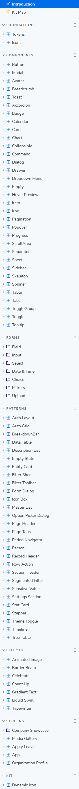

### Field component screenshots

One screenshot per component, taken from local Storybook (`http://localhost:6006`) on 21 Nov 2026.

| Component | Story | Screenshot |
|---|---|---|
| Components/Calendar | Keyboard | 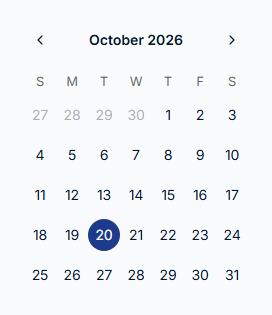 |
| Forms/Choice/Checkbox | Toggle |  |
| Forms/Pickers/Color Picker | Palette | 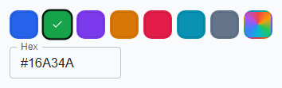 |
| Forms/Select/Combobox | Searchable | 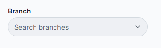 |
| Forms/Date & Time/Date Field | Company Format | 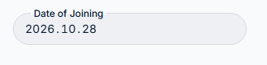 |
| Forms/Date & Time/Date Picker | Pick Day | 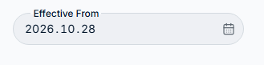 |
| Forms/Field/Field | With Hint | 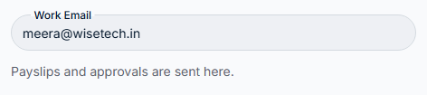 |
| Forms/Upload/File Upload | Images | 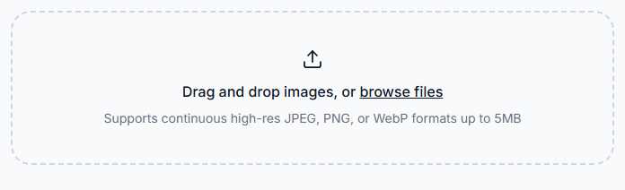 |
| Forms/Input/Input | Default | 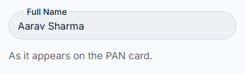 |
| Forms/Input/Input Group | Search | 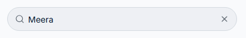 |
| Forms/Input/Input OTP | Default | 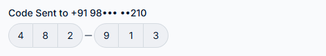 |
| Forms/Field/Label | With Input | 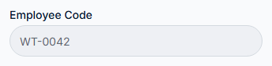 |
| Forms/Input/Number Field | Rupees | 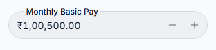 |
| Forms/Choice/Radio Group | Default |  |
| Forms/Select/Select | Choose Option | 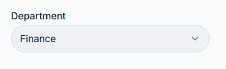 |
| Forms/Choice/Slider | Default | 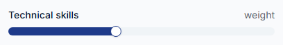 |
| Forms/Choice/Switch | Toggle | 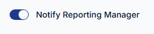 |
| Forms/Input/Textarea | Default | 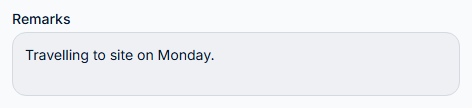 |
| Components/Toggle | Default |  |
| Components/ToggleGroup | View Mode | 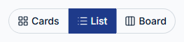 |
| Forms/Choice/Choice Cards | Default | 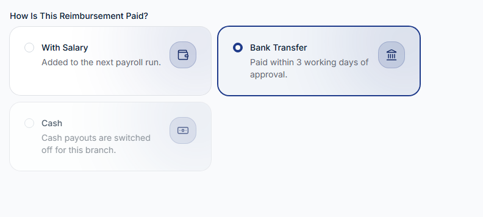 |
| Forms/Upload/Image Field | Round With Image | 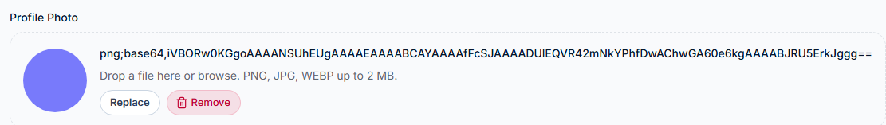 |
| Patterns/Option Picker Dialog | Change Status | 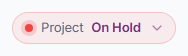 |
| Forms/Input/Password Field | Default | 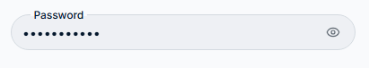 |
| Patterns/Period Navigator | Default | 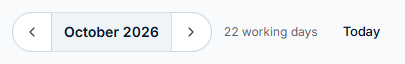 |
| Forms/Select/Person Picker | Search By Code | 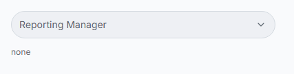 |
| Forms/Input/Phone Field | Default | 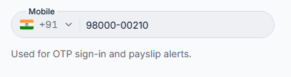 |
| Forms/Select/Search Select | Default | 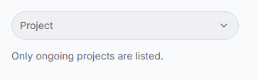 |
| Patterns/Segmented Filter | Basic | 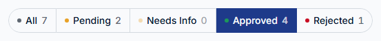 |
| Forms/Upload/Video Field | Upload | 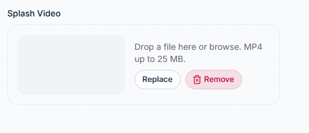 |

### Application component list

> Not captured yet. The MUI and legacy field components (`WtField`, `TextInput`, `WtDateField`, …) have no stories, so they can only be shown on real app screens, which need a logged-in session (`e2e/.auth/user.json` does not exist yet).

## Storybook Components

The v2 kit in `src/ds`, plus two application components that have stories.

| Component | File Path | Type / Category | Usage Count |
|---|---|---|---|
| Field (`Field`, `FieldLabel`, `FieldDescription`, `FieldError`, `FieldGroup`, `FieldSet`, `FieldLegend`, …) | `src/ds/ui/field.tsx` | Field chrome | 32 |
| Input | `src/ds/ui/input.tsx` | Text input | 24 |
| Input Group | `src/ds/ui/input-group.tsx` | Input group / addon | 13 |
| Textarea | `src/ds/ui/textarea.tsx` | Textarea | 13 |
| Label | `src/ds/ui/label.tsx` | Field label | 2 |
| Checkbox | `src/ds/ui/checkbox.tsx` | Checkbox | 6 |
| Switch | `src/ds/ui/switch.tsx` | Switch | 3 |
| Radio Group | `src/ds/ui/radio-group.tsx` | Radio group | 0 |
| Select | `src/ds/ui/select.tsx` | Select | 17 |
| Combobox | `src/ds/ui/combobox.tsx` | Combobox / multi-select | 2 |
| Slider | `src/ds/ui/slider.tsx` | Slider | 0 |
| Toggle | `src/ds/ui/toggle.tsx` | Toggle | 0 |
| Toggle Group | `src/ds/ui/toggle-group.tsx` | Segmented choice | 1 |
| Input OTP | `src/ds/ui/input-otp.tsx` | OTP / PIN | 0 |
| Number Field | `src/ds/ui/number-field.tsx` | Number / currency | 3 |
| Date Field / Time Field | `src/ds/ui/date-field.tsx` | Date / time input | 2 |
| Date Picker / Date Range Picker | `src/ds/ui/date-picker.tsx` | Date picker | 6 |
| Calendar | `src/ds/ui/calendar.tsx` | Calendar | 0 |
| Password Field | `src/ds/patterns/password-field.tsx` | Password input | 3 |
| Phone Field | `src/ds/patterns/phone-field.tsx` | Phone input | 0 |
| Search Select | `src/ds/patterns/search-select.tsx` | Searchable select | 3 |
| Person Picker | `src/ds/patterns/person-picker.tsx` | People picker | 1 |
| Color Picker / Icon Picker (story removed) | `src/ds/patterns/pickers.tsx` | Colour / icon picker | 0 |
| Image Field | `src/ds/patterns/image-field.tsx` | File / image upload | 3 |
| Video Field | `src/ds/patterns/video-field.tsx` | Video upload | 1 |
| Choice Cards | `src/ds/patterns/choice-cards.tsx` | Radio cards | 0 |
| Segmented Filter | `src/ds/patterns/segmented-filter.tsx` | Segmented filter | 2 |
| Option Picker Dialog | `src/ds/patterns/option-picker-dialog.tsx` | Picker dialog | 2 |
| Period Navigator | `src/ds/patterns/period-navigator.tsx` | Period stepper | 4 |
| WtColorPicker (story: Forms/Pickers/Color Picker) | `src/app/modules/common/components/ui/WtColorPicker.tsx` | Colour picker (MUI) | 11 |
| FileUpload (story: Components/File Upload) | `src/app/modules/common/components/FileUpload.tsx` | File upload | 1 |

## Application Components

### MUI product kit: `src/app/modules/common/components/ui`

| Component | File Path | Type / Category | Usage Count |
|---|---|---|---|
| WtField | `src/app/modules/common/components/ui/WtField.tsx` | Text / number / textarea / select | 59 |
| WtFieldFormik | `src/app/modules/common/components/ui/WtFieldFormik.tsx` | Formik field | 34 |
| WtSelect | `src/app/modules/common/components/ui/WtSelect.tsx` | Select engine (react-select) | 11 |
| WtChoice | `src/app/modules/common/components/ui/WtChoice.tsx` | Switch / segmented / cards | 1 |
| WtChoiceField | `src/app/modules/common/components/ui/WtChoiceField.tsx` | Formik choice | 11 |
| WtCheckbox | `src/app/modules/common/components/ui/checkbox.tsx` | Checkbox | 2 |
| WtCheckboxField | `src/app/modules/common/components/ui/checkbox.tsx` | Checkbox + label | 5 |
| WtControlLabel | `src/app/modules/common/components/ui/checkbox.tsx` | Control label | 1 |
| WtSwitch | `src/app/modules/common/components/ui/switch.tsx` | Switch | 18 |
| WtSwitchField | `src/app/modules/common/components/ui/switch.tsx` | Switch + label | 18 |
| WtPhoneField | `src/app/modules/common/components/ui/WtPhoneField.tsx` | Phone input | 3 |
| WtPhoneFieldFormik | `src/app/modules/common/components/ui/WtPhoneFieldFormik.tsx` | Formik phone | 2 |
| WtMoneyField | `src/app/modules/common/components/ui/WtMoneyField.tsx` | Currency input | 3 |
| PinInput | `src/app/modules/common/components/ui/PinInput.tsx` | OTP / PIN | 4 |
| FloatingLabels / FloatingLabelFrame | `src/app/modules/common/components/ui/FloatingLabel.tsx` | Field label | 8 |
| ToolbarFilterSelect | `src/app/modules/common/components/ui/ToolbarFilterSelect.tsx` | Filter select | 3 |
| WtDateField | `src/app/modules/common/components/ui/dates.tsx` | Date picker (MUI X) | 22 |
| WtDateTimeField | `src/app/modules/common/components/ui/dates.tsx` | Date-time picker (MUI X) | 1 |
| FiscalYearRangeField | `src/app/modules/common/components/ui/FiscalYearRangeField.tsx` | Date range (kit) | 5 |
| IconPicker | `src/app/modules/common/components/ui/SwatchPicker.tsx` | Icon picker | 1 |
| SegmentedControl | `src/app/modules/common/components/ui/SegmentedControl.tsx` | Segmented choice | 18 |
| ContactPicker | `src/app/modules/common/components/ui/ContactPicker.tsx` | Contact picker | 1 |
| WtImageField | `src/app/modules/common/components/ui/WtImageField.tsx` | Image upload | 0 |
| OptionPickerDialog | `src/app/modules/common/components/ui/pickers.tsx` | Picker dialog | 3 |
| WeightSliderList | `src/app/modules/common/components/ui/WeightSliderList.tsx` | Slider | 2 |

### Legacy Formik adapters: `src/app/modules/common/inputs`

| Component | File Path | Type / Category | Usage Count |
|---|---|---|---|
| TextInput | `src/app/modules/common/inputs/TextInput.tsx` | Text input (on kit) | 36 |
| TextAreaInput | `src/app/modules/common/inputs/TextAreaInput.tsx` | Textarea (on kit) | 3 |
| NumberInput | `src/app/modules/common/inputs/NumberInput.tsx` | Number input | 1 (never rendered) |
| DropDownInput | `src/app/modules/common/inputs/DropdownInput.tsx` | Select (kit Combobox) | 11 |
| SelectInput | `src/app/modules/common/inputs/SelectInput.tsx` | Select (WtSelect) | 1 (never rendered) |
| LocationDropdown | `src/app/modules/common/inputs/LocationDropdown.tsx` | Location select | 1 |
| ReimbursementDropdown | `src/app/modules/common/inputs/ReimbursementDropdown.tsx` | Select | 0 |
| ColourOption / SingleValue / AvatarOption / … | `src/app/modules/common/inputs/ColorInDropdwon.tsx` | react-select parts | 2 |
| DateInput | `src/app/modules/common/inputs/DateInput.tsx` | Date picker (kit) | 5 |
| PlainDatePicker | `src/app/modules/common/inputs/PlainDatePicker.tsx` | Date picker (MUI X) | 1 |
| MonthYearInput | `src/app/modules/common/inputs/MonthYearInput.tsx` | Month / year picker | 2 |
| TimePickerInput | `src/app/modules/common/inputs/TimeInput.tsx` | Time picker | 2 |
| Flatpickr | `src/app/modules/common/inputs/Flatpickr.tsx` | Date picker (Flatpickr) | 4 |
| PhoneInputField | `src/app/modules/common/inputs/PhoneInput.tsx` | Phone input | 0 |
| GstinInput | `src/app/modules/common/inputs/GstinInput.tsx` | GST input | 1 |
| PanInput | `src/app/modules/common/inputs/PanInput.tsx` | PAN input | 1 |
| FileInput | `src/app/modules/common/inputs/FileInput.tsx` | File input | 3 |
| SignatureInput | `src/app/modules/common/inputs/SignatureInput.tsx` | Signature pad | 1 |

### Shared application components

| Component | File Path | Type / Category | Usage Count |
|---|---|---|---|
| TimePickerField | `src/app/modules/common/components/TimePickerField.tsx` | Time picker (MUI X) | 7 |
| MultiSelectWithInlineCreate | `src/app/modules/common/components/MultiSelectWithInlineCreate.tsx` | Multi-select | 5 |
| EmployeePickerField | `src/app/modules/common/components/EmployeePickerField.tsx` | People picker | 4 |
| AllEmployeesSearchDropdown | `src/app/modules/common/components/AllEmployeesSearchDropdown.tsx` | People picker | 6 |
| EmployeeSelectionDialog | `src/app/modules/common/components/EmployeeSelectionDialog.tsx` | People picker dialog | 4 |
| DragDropFileField | `src/app/modules/common/components/DragDropFileField/index.tsx` | File upload | 5 |
| SmartLocationPicker | `src/app/modules/common/components/SmartLocationPicker.tsx` | Location picker | 3 |
| TimePeriodDropdown | `src/app/modules/common/components/TimePeriodDropdown.tsx` | Period select | 4 |
| StatusToggle | `src/app/modules/common/components/StatusToggle.tsx` | Segmented toggle | 0 |
| PrivacyToggle | `src/app/modules/common/components/PrivacyToggle.tsx` | Toggle | 1 |
| PeriodNavigator (wrapper) | `src/app/modules/common/components/PeriodNavigator.tsx` | Period stepper | 15 |
| DepartmentDesignationFields | `src/app/modules/common/components/DepartmentDesignationFields.tsx` | Composite fields | 2 |
| CompactPeoplePicker | `src/app/modules/common/components/SecurityPin/CompactPeoplePicker.tsx` | People picker | 1 |
| PhoneNumberInput | `src/app/components/PhoneNumberInput.tsx` | Formik phone | 8 |
| DateSelector | `src/components/DateSelector.tsx` | Period stepper | 4 |
| DropdownAdd | `src/app/modules/common/utils/DropdownAdd.tsx` | Select (react-select) | 1 |

### Feature-local field components

| Component | File Path | Type / Category | Usage Count |
|---|---|---|---|
| TextEditor / NumberEditor / SelectEditor / SearchableSelectEditor / DateEditor / ToggleEditor | `src/app/modules/detail-page/EditableDetailCard.tsx` | Inline editors | 3 |
| HierarchicalTaskSelect / HierarchicalTaskPicker | `src/app/pages/employee/tasks/components/HierarchicalTaskSelect.tsx` | Tree select | 4 |
| LabelledTimeField | `src/app/pages/employee/tasks/components/primitives.tsx` | Time picker | 1 |
| FormField | `src/app/pages/employee/tasks/employeTeamLevel/components/FormModal/FormField.tsx` | Field label (Bootstrap) | 1 |
| PersonPicker | `src/app/pages/employee/courtesy-desk/components/PersonPicker.tsx` | People picker | 3 |
| MiniSelect / Segmented | `src/modules/document-editor/controls.tsx` | Select / segmented | 3 |
| LabelledSwitch | `src/modules/document-editor/LabelledSwitch.tsx` | Switch | 1 |
| GstNumberField / GstStateField / PanNumberField / StatutoryDocumentField | `src/app/pages/employee/companies/companies/components/GstStatutory.tsx` | Statutory fields | 3 |
| MultiSelectInput | `src/app/pages/dashboard/views/MultiSelectInput.tsx` | Multi-select | 0 |
| ScrollableNumberInput | `src/app/pages/employee/leads/lead/components/MeetingConfigurationTable.tsx` | Number input | Local |
| ScrollableNumberInput | `src/app/pages/employee/leads/lead/components/PercentageConfigurationTable.tsx` | Number input | Local |
| MoneyField / SelectField | `src/app/pages/billing/project/BillDialogs.tsx` | Currency / select | Local |
| UploadDropzone | `src/app/pages/employee/leads/lead/components/dms/components/UploadDropzone.tsx` | File upload | 1 |
| BirthdayField | `src/app/pages/employee/companies/contacts/components/BirthdayField.tsx` | Date fields | 1 |

## Duplicate Components

| Duplicate | Files |
|---|---|
| Three Formik phone adapters over `WtPhoneField` | `src/app/components/PhoneNumberInput.tsx`, `src/app/modules/common/components/ui/WtPhoneFieldFormik.tsx`, `src/app/modules/common/inputs/PhoneInput.tsx` |
| Phone input (same `react-international-phone` engine) | `src/app/modules/common/components/ui/WtPhoneField.tsx`, `src/ds/patterns/phone-field.tsx` |
| `ScrollableNumberInput` (identical code) | `MeetingConfigurationTable.tsx`, `PercentageConfigurationTable.tsx` |
| `OptionPickerDialog` (same name, different API) | `src/app/modules/common/components/ui/pickers.tsx`, `src/ds/patterns/option-picker-dialog.tsx` |
| `IconPicker` (same name) | `src/app/modules/common/components/ui/SwatchPicker.tsx`, `src/ds/patterns/pickers.tsx` |
| Colour picker and `KIT_SWATCHES` / `ColorSwatch` | `src/app/modules/common/components/ui/WtColorPicker.tsx`, `src/ds/patterns/pickers.tsx` |
| `PeriodNavigator` and period steppers | `src/ds/patterns/period-navigator.tsx`, `src/app/modules/common/components/PeriodNavigator.tsx`, `src/components/DateSelector.tsx` |
| `DateInput` (same name, different component) | `src/ds/ui/date-field.tsx`, `src/app/modules/common/inputs/DateInput.tsx` |
| PIN / OTP | `src/app/modules/common/components/ui/PinInput.tsx`, `src/ds/ui/input-otp.tsx` |
| People pickers (8+) | `EmployeePickerField`, `AllEmployeesSearchDropdown`, `EmployeeSelectionDialog`, `CompactPeoplePicker`, courtesy-desk `PersonPicker`, kit `PersonPicker`, `EmployeePicker` (`DeductionMaster.tsx`), `InternalPicker` / `ExternalPicker` (`MomAttendees.tsx`) |

## Components Missing from Storybook

- **MUI kit:**
  - `WtField`, `WtFieldFormik`, `WtSelect`
  - `WtChoice`, `WtChoiceField`
  - `WtCheckbox`, `WtCheckboxField`, `WtControlLabel`
  - `WtSwitch`, `WtSwitchField`
  - `WtPhoneField`, `WtPhoneFieldFormik`, `WtMoneyField`, `PinInput`
  - `FloatingLabels`, `ToolbarFilterSelect`
  - `WtDateField`, `WtDateTimeField`, `FiscalYearRangeField`
  - `SegmentedControl`, `IconPicker`, `ContactPicker`, `OptionPickerDialog`, `WeightSliderList`
- **Legacy adapters:** every component in `src/app/modules/common/inputs`.
- **Shared application components:**
  - `TimePickerField`, `MultiSelectWithInlineCreate`
  - `EmployeePickerField`, `AllEmployeesSearchDropdown`, `EmployeeSelectionDialog`
  - `DragDropFileField`, `PhoneNumberInput`, `DateSelector`
  - `SmartLocationPicker`, `TimePeriodDropdown`, `CompactPeoplePicker`, `HierarchicalTaskSelect`

## Components with No Application Usage

| Component | File Path |
|---|---|
| WtImageField | `src/app/modules/common/components/ui/WtImageField.tsx` |
| ReimbursementDropdown | `src/app/modules/common/inputs/ReimbursementDropdown.tsx` |
| PhoneInputField | `src/app/modules/common/inputs/PhoneInput.tsx` |
| SelectMenuAddRow exports | `src/app/modules/common/inputs/SelectMenuAddRow.tsx` |
| StatusToggle | `src/app/modules/common/components/StatusToggle.tsx` |
| MultiSelectInput | `src/app/pages/dashboard/views/MultiSelectInput.tsx` |
| NumberInput (imported, never rendered) | `src/app/modules/common/inputs/NumberInput.tsx` |
| SelectInput (imported, never rendered) | `src/app/modules/common/inputs/SelectInput.tsx` |
| Kit: Phone Field, Input OTP, Radio Group, Slider, Toggle, Calendar, Color / Icon Picker, Choice Cards, Time Field | `src/ds/ui/*`, `src/ds/patterns/*` (stories and prototypes only) |

## Important Observations

- **Usage is spread across 5 layers:** the kit (`src/ds`), the MUI kit (`common/components/ui`), the legacy adapters (`common/inputs`), shared application components, and feature-local copies.
- **The most-used field components are not in Storybook:**

  | Component | App files |
  |---|---|
  | `WtField` | 59 |
  | `TextInput` | 36 |
  | `WtFieldFormik` | 34 |
  | `WtDateField` | 22 |

- **Some legacy and MUI-named components already render kit parts:** `TextInput`, `TextAreaInput`, `DateInput`, `DropDownInput`, `FiscalYearRangeField`.
- **Raw field usage that bypasses the shared components** (product files):

  | Raw usage | Files |
  |---|---|
  | Native `<input>` | 83 |
  | MUI `TextField` | 52 |
  | Bootstrap `.form-control` | 36 |
  | Native `<select>` | 18 |
  | `react-select` imported directly | 10 |
  | `@mui/x-date-pickers` imported directly | 11 |

- **Prop names are inconsistent:**
  - Error: `error` (string or boolean), `invalid` or `errorMessage`.
  - Hint: `hint`, `helperText` or `description`.
  - Required: `required` or `isRequired`.
  - Size: `sm` / `md` or `default` / `lg`.
- **Files over 600 lines:**
  - `WtField.tsx` (847)
  - courtesy-desk `PersonPicker.tsx` (1013)
  - `HierarchicalTaskSelect.tsx` (692)
- **Outdated references:**
  - `common/components/ui/README.md` lists `TimeWheelField`, which no longer exists.
  - `AGENTS.md` points to `src/components/ui/button/Button.tsx` and `src/components/form/input/InputField.tsx`, which do not exist.
  - The Calendar row in `docs/PROJECT-INVENTORY.md` lists `FiscalYearRangeField` and `DateInput` under MUI X; both now use the kit.
  - `KitMap.mdx` maps `OptionPickerDialog` to Combobox, but the kit still ships an Option Picker Dialog.
- **Empty file:** `src/app/modules/offer-v2/components/editor/Toolbar.tsx` is 0 bytes. No rich text editor exists in the project.
