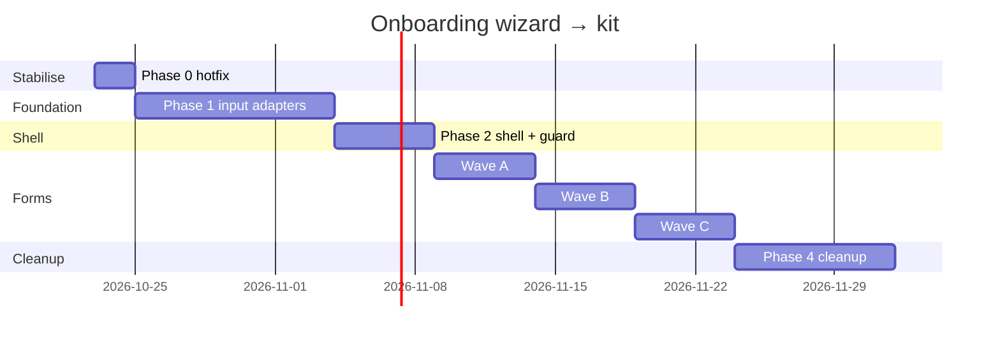

# Onboarding Wizard → Shared UI Kit: 360° Migration Plan

**Status:** Implementation complete for the active onboarding flow · **Date:** 2026-10-22 · **Owner:** Frontend
**Scope:** `/employees/create-new` and `/employees/edit/:employeeId` (`NewEmployeeWizard` + onboarding sections + step forms + shared inputs)
**Companions:** `docs/bootstrap-to-kit-migration.md` · `src/app/modules/common/components/ui/README.md` · `AGENTS.md` · `docs/HANDBOOK.md`

> **Why now:** the migration doc lists the employee wizard as moved to `WtFieldFormik` ("Done 2026-10-12"), but an audit on 2026-10-22 found the wizard still renders almost every field through the legacy input layer and Bootstrap markup. A production crash (React #130 in `PhoneNumberInput`, which blocked employee creation) also came from a non-kit dependency inside this flow.

---

## 1. Goal (SMART)

| | |
|---|---|
| **Specific** | Every visible control, dialog, toast and layout primitive in the onboarding wizard comes from the kit barrel `@app/modules/common/components/ui`. No `react-bootstrap`, raw `react-select`, direct `react-toastify`, Metronic `KTIcon`/`StepperComponent` or Bootstrap grid/form classes remain in wizard files. |
| **Measurable** | Audit script (§9) reports **0** legacy hits across the wizard file set. All wizard files are removed from `.eslint-ui-baseline.cjs`. Create and edit employee E2E passes in light and dark mode, desktop and mobile. |
| **Achievable** | Shared-inputs-first: 4 inputs (`TextInput`, `RadioInput`, `DropdownInput`, `MonthYearInput`) feed ~21 step forms, so swapping them moves most of the wizard at once. |
| **Relevant** | Unblocks dark mode, Appearance (glass/material), the unsaved-changes guard, and removes the CJS-interop crash class from this flow. |
| **Time-bound** | 4 sprints (~8 working weeks), one PR per surface or per shared primitive (doc rule A2.3). |

**Out of scope:** backend payloads, Yup schema rules (only moved, not changed), data fetching in `OnboardingWorkspace`, redesigning the step order.

---

## 2. Current state (audit 2026-10-22)

Heuristic import/class scan, so treat counts as signals.

### 2.1 Shell

| File | Lines | Kit usage | Legacy found | Verdict |
|---|---|---|---|---|
| `pages/employee/wizard/NewEmployeeWizard.tsx` | ~2.2k | `confirmDialog`, `AppIcon` | Metronic `StepperComponent`, `KTIcon`, `PageTitle`; `@utils/modal` success/error confirmations | Partial |
| `pages/employee/forms/shared/FullscreenWizardModal.tsx` | 55 | `UnsavedChangesModal` (compat wrapper) | `KTIcon` | Partial |
| `pages/employee/forms/onboarding/OnboardingWorkspace.tsx` | ~825 | `AppIcon` | none | Mostly OK |
| `pages/employee/forms/onboarding/OnboardingWizard.tsx` | ~800 | `WtButton`, `IconBox`, `TRIO`, `AppIcon` | `react-toastify` direct, 7 hex, 6 BS classes · **in baseline** | Partial |
| `pages/employee/forms/onboarding/OnboardingSections.tsx` | ~660 | none | `DropdownInput`, `TextInput`, `RadioInput`, `MonthYearInput`; 21 BS classes | Legacy |

### 2.2 Shared inputs

| File | Verdict | Target |
|---|---|---|
| `modules/common/inputs/TextInput.tsx` | Legacy | `WtFieldFormik` |
| `modules/common/inputs/RadioInput.tsx` (7 hex) | Legacy | `SegmentedControl` (2–5 options) / kit radio in `WtField` |
| `modules/common/inputs/DropdownInput.tsx` | Legacy ("do not expand") | `WtFieldFormik` (+ `searchable`, `addOption`) / `MultiSelectWithInlineCreate` |
| `modules/common/inputs/MonthYearInput.tsx` | Legacy | `WtDateField` (month/year views) |
| `components/PhoneNumberInput.tsx` | Not kit; `react-phone-input-2` (CJS, caused #130) | New kit primitive `WtPhoneField` |
| `modules/common/components/SmartLocationPicker.tsx` | Raw MUI + Leaflet · **in baseline** | Move into kit as `WtLocationField` (wrapping existing logic) |
| `components/ApprovalSettings.tsx` | Raw `react-select` + BS classes | `WtField` / `WtSelect` adapter |
| `employee/forms/shared/FormPrimitives.tsx` | Mostly kit | Fold into `FormSection` / `InlineNotice` |
| `modules/common/utils/AddAnotherBtn.tsx` | Mostly kit | Keep / move into barrel |

### 2.3 Step forms (`pages/employee/wizard/forms/*`)

| Form | BS classes | Hex | Baseline | Priority |
|---|---|---|---|---|
| AddressInfo | 16 | 2 | | P1 |
| EmployeeInfo | 13 | 0 | | P1 |
| BankInfo | 9 | 0 | | P2 |
| PersonalContactInfo | 9 | 0 | | P1 (phone) |
| BasicInfo | 8 | 0 | | P1 |
| AppSettings | 7 | 0 | | P3 |
| HiringInfo | 6 | 5 | ✔ | P2 |
| MealPreference | 5 | 0 | | P3 |
| Documents | 4 | 0 | | P2 |
| WorkContactInfo | 3 | 0 | | P1 (phone) |
| RejoinHistory | 3 | 1 | ✔ | P3 |
| LeaveAllocationStep | 2 | 0 | ✔ | P2 |
| EducationInfo | 0 | 0 | ✔ | P2 (`DropdownInput` +Add) |
| FamilyInfo | 0 | 0 | ✔ | P3 |
| WorkExperience | 0 | 0 | ✔ | P3 |
| EmergencyDetails | 0 | 0 | | P3 (verify phone) |
| ReferrerInput | 0 | 0 | | P2 (verify `react-select` usage) |
| ProfilePicture / PhotoEditorModal / AppRoleField | 0 | ≤1 | | Verify only |

---

## 3. Reasoning (why this order)

1. **Leverage:** 4 shared inputs back ~21 forms. Replace or adapt them first and most fields migrate without touching each form.
2. **Risk first:** `PhoneNumberInput` already crashed prod. It goes in Phase 0 as a hotfix, then becomes a kit primitive.
3. **Shell before content:** the dialog, stepper and footer decide the unsaved-changes behaviour and layout tokens every step inherits.
4. **Layout last per form:** once fields are kit controls, swapping Bootstrap `row/col` for `FormSection` + MUI `Grid`/`Stack` is mechanical.
5. **Ratchet:** each PR deletes its files from `.eslint-ui-baseline.cjs`, so progress can't regress.

---

## 4. Phased plan

### Phase 0 — Stabilise (days 1–2) · hotfix
- [x] Unwrap CJS default for `react-phone-input-2` with `resolveReactComponent` in `components/PhoneNumberInput.tsx` **and** `modules/common/inputs/PhoneInput.tsx`.
- [x] Add a regression test: render `PhoneNumberInput` and assert no throw.
- [x] Add a CI smoke step: `vite build` + preview + load `/employees/create-new` (catches interop crashes that dev mode hides).
- [x] Add Amplify SPA rewrite (`/<*>` → `/index.html`, 200) so deep links like `/employees/create-new` don't 404 on refresh.
- **Exit:** create-employee works in prod on desktop + iOS Safari.

### Phase 1 — Shared inputs as kit adapters (week 1–2)
Strategy: **adapter, not big-bang.** Keep the legacy component names and props and reimplement them on top of kit primitives, so every caller upgrades with no call-site change. Then migrate callers to the kit API directly in later phases and delete the adapters.

- [x] `TextInput` now delegates rendering to `WtField` while preserving its Formik adapter contract.
- [x] `RadioInput` now delegates rendering to `SegmentedControl` while preserving its Formik adapter contract.
- [x] `MonthYearInput` now delegates rendering to `WtDateField` with year/month views while preserving its Formik adapter contract.
- [x] Added ESM-safe `WtPhoneField` and moved `PhoneNumberInput` / `PhoneInput` adapters off `react-phone-input-2`.

| Legacy | Adapter implementation | Notes |
|---|---|---|
| `TextInput` | `WtFieldFormik` | Preserve `formikField`, `isRequired`, error display |
| `RadioInput` | `SegmentedControl` (≤5) / `WtField` radio | Remove 7 hard-coded hex |
| `MonthYearInput` | `WtDateField` (`views={['year','month']}`) | dayjs format parity |
| `DropdownInput` | `WtFieldFormik` + `searchable` + `addOption` | Avatar/colour variants → `WtSelect` adapter only |

- [x] New kit primitive **`WtPhoneField`** (ESM-safe; country picker from `@utils/dialCodes`). Keep the `PhoneNumberInput` props as an adapter.
- [x] Document all of the above in `ui/README.md` (component index + "Labelled inputs").
- [ ] Storybook or visual snapshots (if available) for each adapter: light/dark, error, disabled.
- **Exit:** every wizard field renders through kit primitives; no visual regressions in screenshots.

### Phase 2 — Shell (week 3)
- [x] `FullscreenWizardModal` → `GlassDialog` (`preset="workspace"`) + `GlassHeader`; drop `UnsavedChangesModal` compat wrapper.
- [ ] Wire **`useUnsavedChangesGuard(formik.dirty)`** for Cancel / X / Escape / backdrop / browser Back / reload (ties into the unsaved-changes SMART plan).
- [ ] Replace Metronic `StepperComponent` with kit stepper (build `WtStepper` in the kit if absent; vertical on desktop, compact on mobile).
- [x] `KTIcon` → `AppIcon`; `PageTitle` → `EntityPageHeader`.
- [x] `@utils/modal` success/error + `react-toastify` → kit `toast` / `confirmDialog` / `alertDialog`.
- [ ] Footer → `GlassDialogActions` (navy primary + white ghost Cancel).
- **Exit:** shell files contain no `@metronic`, `react-toastify`, `@utils/modal` imports.

### Phase 3 — Step forms (weeks 4–6)
One PR per 2–3 related forms, in priority order from §2.3.

Per-form checklist:
- [x] Fields use `WtFieldFormik` / `WtDateField` / `WtPhoneField` / `SegmentedControl` directly (not the adapters) in the active onboarding sections.
- [x] Bootstrap `row` / `col-*` / `form-*` / `card` → kit/MUI layout primitives in the active onboarding sections.
- [ ] Hex colours → theme tokens / `toneSurface(trio, dark)`.
- [ ] Repeating rows ("Add another") → `AddAnotherBtn` from barrel + `ReorderableGroup` where order matters.
- [ ] `OnboardingSections.tsx` section wrappers → `FormSection` / `SettingsSection`.
- [ ] `SmartLocationPicker` → kit `WtLocationField` (keep Nominatim logic; fix interop of icons / react-leaflet).
- [x] `ApprovalSettings` → `WtField` / `MultiSelectWithInlineCreate`; no raw `react-select`.
- [ ] Remove file from `.eslint-ui-baseline.cjs`; `pnpm run lint` clean.

**Wave A (P1):** BasicInfo, EmployeeInfo, AddressInfo (+ location), PersonalContactInfo, WorkContactInfo (+ phone)
**Wave B (P2):** BankInfo, HiringInfo, Documents, LeaveAllocationStep, EducationInfo, ReferrerInput, ApprovalSettings
**Wave C (P3):** AppSettings, MealPreference, FamilyInfo, WorkExperience, EmergencyDetails, RejoinHistory

### Phase 4 — Cleanup & hardening (weeks 7–8)
- [ ] Switch callers off adapters; delete `TextInput`, `RadioInput`, `MonthYearInput` if no other consumers (grep first). `DropdownInput` → shrink to avatar/colour only, per doc.
- [ ] Split `NewEmployeeWizard.tsx` (~2.2k lines): `useEmployeeWizardSubmit`, `useEmployeeWizardInitialValues`, schema module.
- [ ] Update `docs/bootstrap-to-kit-migration.md` §3.4: correct the "Done 2026-10-12" row and record actual completion.
- [ ] Add ESLint `no-restricted-imports` for legacy inputs inside `pages/employee/**`.

---

## 5. The 360° view

| Dimension | What we do | Done when |
|---|---|---|
| **UI / design system** | Kit primitives only; tokens, no hex | Audit = 0 legacy hits |
| **UX** | Same step order and labels; consistent 46px controls; mobile-friendly stepper | Side-by-side review signed off |
| **Unsaved changes** | `useUnsavedChangesGuard` on every exit | QA matrix all green |
| **Accessibility** | Labels bound to inputs, focus order per step, Escape handling, error text announced (`aria-describedby`), stepper `aria-current` | axe: 0 serious/critical |
| **Theming** | Light + dark; glass + material | Screenshots for both |
| **Responsive** | 360px → 1440px; iOS Safari (the crash device) | Manual pass on iPhone + desktop |
| **Validation** | Yup schemas unchanged, moved to one module; errors render via kit field | Existing validation tests pass |
| **Data / API** | Payload builders untouched (`createNewUser`, `updateUser`, `buildEducationPayload`) | Payload snapshot test equal before/after |
| **Performance** | Lazy-load heavy steps (map, photo editor); no new vendor chunks | Wizard chunk size ≤ current |
| **Build / interop** | No default-import of CJS UI libs without `resolveReactComponent`; prod-build smoke in CI | CI smoke green |
| **Security / privacy** | No PII in `/api/client-error` logs beyond what exists today; no tokens in logs | Reviewed |
| **Testing** | Unit (adapters), RTL (each step renders + validates), E2E create & edit | All green in CI |
| **Observability** | Keep client-error reporter; tag with wizard step id | Errors attributable to a step |
| **Docs** | Kit README index + migration doc updated | Merged |
| **Rollout** | Feature flag `wizardKitV2` (Flags or env) for the shell swap; fall back to old shell for 1 sprint | Flag removed after 1 clean sprint |

---

## 6. Testing strategy

**QA matrix (run per wave):**

| Scenario | Create | Edit |
|---|---|---|
| Fill all required → submit | ✔ | ✔ |
| Validation errors per step | ✔ | ✔ |
| Phone: country switch, paste, extension | ✔ | ✔ |
| Location: search, pin drop, postcode fill | ✔ | ✔ |
| Education/Family/Experience: add, remove, reorder rows | ✔ | ✔ |
| Documents upload + profile picture crop | ✔ | ✔ |
| Dirty → Cancel / X / Esc / Back / reload prompts | ✔ | ✔ |
| Clean → close silently | ✔ | ✔ |
| Light/dark, glass/material | ✔ | ✔ |
| iPhone Safari + desktop Chrome | ✔ | ✔ |
| Prod build (`vite build && vite preview`) | ✔ | ✔ |

---

## 7. Risks & mitigations

| Risk | Impact | Mitigation |
|---|---|---|
| Adapter prop mismatch silently changes values (e.g. dial code, month format) | Bad data saved | Payload snapshot tests before/after each phase |
| CJS interop crashes only in prod build | Wizard down | CI prod-build smoke; `resolveReactComponent` for CJS UI deps |
| 2.2k-line `NewEmployeeWizard` merge conflicts | Slow PRs | Phase-4 split; small PRs; land shell changes first |
| `DropdownInput` used outside the wizard | Regressions elsewhere | Adapter keeps the API; grep consumers before deleting |
| Doc says "done" while it isn't | Wrong priorities | Correct §3.4 in Phase 4; audit script in CI |
| Unsaved-changes prompt after successful save | Annoying UX | Reset Formik `dirty` before close |

---

## 8. Timeline



---

## 9. Measuring progress (audit script)

```bash
FILES=$(git ls-files 'src/app/pages/employee/wizard/**/*.tsx' 'src/app/pages/employee/forms/**/*.tsx' \
  src/app/modules/common/inputs/{TextInput,RadioInput,DropdownInput,MonthYearInput}.tsx \
  src/app/components/{PhoneNumberInput,ApprovalSettings}.tsx \
  src/app/modules/common/components/SmartLocationPicker.tsx)

# legacy imports
rg -n "from ['\"](react-bootstrap|antd|@mantine/|react-toastify|sweetalert2|react-select|react-phone-input-2)" $FILES
rg -n "inputs/(TextInput|RadioInput|DropdownInput|MonthYearInput)|@metronic/" $FILES
# bootstrap markup & hex
rg -n "className=[\"'][^\"']*\b(form-control|form-select|form-label|btn-|row|col-\w*\d|card)\b" $FILES
rg -n "#[0-9a-fA-F]{6}\b" $FILES
# baseline ratchet
rg -n "employee/(wizard|forms)|SmartLocationPicker|inputs/" .eslint-ui-baseline.cjs
```
Target: every command returns nothing.

---

## 10. Definition of done
- [ ] Audit script returns 0 hits.
- [ ] No wizard file in `.eslint-ui-baseline.cjs`.
- [ ] QA matrix green in prod build, desktop + iOS.
- [ ] Unsaved-changes guard on all exits.
- [ ] Kit README + migration doc updated; feature flag removed.
