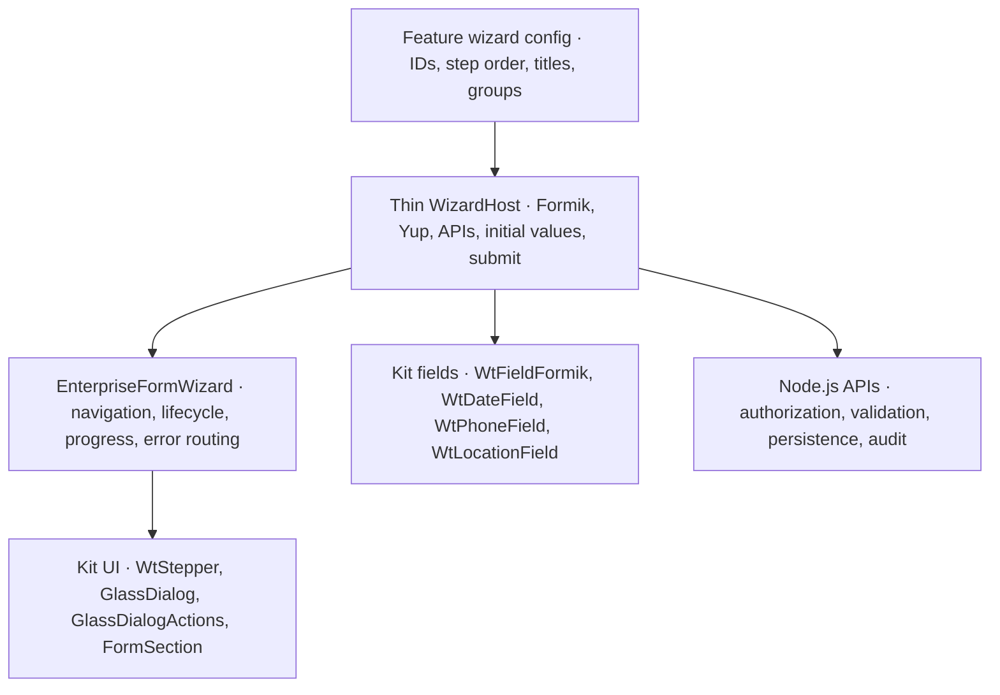
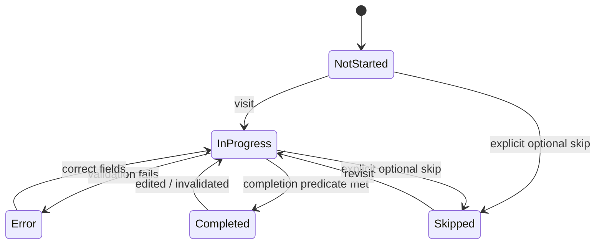

# WISETECH ERP — Unified Wizard Engine Contract

**Status:** Proposed technical specification · **Version:** 1.0-draft · **Date:** 2026-10-22  
**Owner:** Frontend Architecture · **Reviewers:** Backend, QA, Product/UX  
**Governing plan:** [`wizard-engine-unification.md`](./wizard-engine-unification.md)  
**Companions:** [`wizard-ux-contract.md`](./wizard-ux-contract.md) · [`wizard-migration-acceptance.md`](./wizard-migration-acceptance.md)

> **Decision inherited from the master plan:** `src/shared/form-engine` → `EnterpriseFormWizard` becomes the sole shared engine for ordinary multi-step create/edit forms. `OnboardingWizard`, `FullscreenWizardModal`, and hand-built monolith wizards are retired after parity sign-off. This document **proposes contract additions**; exact existing TypeScript exports and kit capabilities must be checked against the repository before merging.

## 1. Architecture responsibilities



| Layer | Owns | Must not own |
|---|---|---|
| `EnterpriseFormWizard` | Navigation state, step visibility/progress, layout variants, focus routing, exit interception, common statuses | Employee/lead-specific API calls, payroll logic, DB shapes |
| Config per feature | Ordered steps, groups, step IDs, labels, component/render refs, summary descriptors, optional/visibility rules | Shared shell and footer implementation |
| Thin host | Data fetch/hydration, Formik, Yup, field adapters, submit, server error mapping, feature flags | Custom stepper, cloned footer, independent exit dialog |
| Kit | `WtStepper`, `GlassDialog`, `GlassDialogActions`, `FormSection`, kit `toast`, `WtField*`, theme tokens | Feature-specific business logic |
| Backend | Authorize, validate business invariants, persist, audit, handle conflicts | Trust browser step completion or UI hiding for security |

**Hard constraint:** No `if (module === 'employee')` / `if (module === 'lead')` inside the engine. Solve exceptions with documented generic extension points or leave them in feature hooks.

## 2. Existing technology and migration constraints (from master plan)

- Keep the existing `EnterpriseWizardStep[]`, `WizardSummaryConfig`, and `WizardActionConfig` APIs compatible wherever feasible.
- Existing A engine supports `LeadWorkspace`, `CompanyWorkspace`, `ContactWorkspace`; hardening these must not silently break them.
- New engine presentation modes are proposed as `presentation: 'modal' | 'page'`.
- Navigation layouts are proposed as `layout: 'steps' | 'sections'`.
- `moduleIcon` (Bootstrap class) must be deprecated in favor of `icon?: AppIconName` with temporary compatibility shim.
- Migrate `WizardSidebar` toward `WtStepper`, but **audit WtStepper's nested-group, state, focus, and controlled-navigation API first**; don't assume unverified support.
- Use `GlassDialog` (workspace preset where applicable), `GlassDialogActions`, `FormSection`, kit `toast`, `useUnsavedChangesGuard`, and approved kit field components.
- Remove Bootstrap/Metronic/raw `react-select`/legacy field imports from **migrated wizard feature files** per the master plan's ESLint ratchet. Third-party internals inside approved kit adapters are a separate concern.
- Existing backend payload fields and validation must remain compatible; rename UI labels via explicit mappers, not stealth schema updates.

## 3. Suggested public contract (illustrative TypeScript)

The following extends rather than replaces your existing `formEngine.types.ts`. Treat as a **target shape**, not drop-in code until aligned with current exports.

```ts
// Proposed additions / refinements only.
type WizardPresentation = 'modal' | 'page';
type WizardLayout = 'steps' | 'sections';
type WizardStepStatus =
  | 'not_started'
  | 'in_progress'
  | 'completed'
  | 'error'
  | 'skipped';

type WizardNavigationPolicy =
  | 'sequential'             // Validate before moving ahead.
  | 'completed-or-previous'  // Can revisit completed/prior steps.
  | 'free';                  // Direct access when business rules allow.

type WizardValidationResult = {
  valid: boolean;
  fieldErrors?: Record<string, string>;
  formError?: string;
};

type WizardStepDefinition<TValues> = {
  id: string;                  // Stable across save/reopen/reorder.
  title: string;
  description?: string;
  groupId?: string;             // Group is not another progress unit.
  optional?: boolean;
  isApplicable?: (values: TValues) => boolean;
  isComplete?: (values: TValues, context: unknown) => boolean;
  validateStep?: (
    values: TValues
  ) => Promise<WizardValidationResult>;
  // Existing component/render & requiredFields stay supported.
};

type DraftAdapter<TValues> = {
  load: (id: string) => Promise<unknown>;
  save: (id: string, draft: WizardDraft<TValues>) => Promise<void>;
  remove: (id: string) => Promise<void>;
};

type WizardDraft<TValues> = {
  schemaVersion: number;
  flowId: string;
  recordId?: string;
  activeStepId: string;
  values: TValues;
  updatedAt: string;
  revision?: string;
};

type WizardOptions<TValues> = {
  id: string;
  title: string;
  presentation: WizardPresentation;
  layout: WizardLayout;
  navigationPolicy?: WizardNavigationPolicy;
  steps: WizardStepDefinition<TValues>[];
  persistDraft?: {
    key: string;
    adapter?: DraftAdapter<TValues>;
    schemaVersion?: number;
  };
  // Existing WizardSummaryConfig and WizardActionConfig remain.
  // Existing/onward telemetry should include flow and step IDs.
};
```

**Compatibility requirement:** Add only fields necessary for migration; do not build a second incompatible schema. Record every API addition in a migration PR and document fallback behavior for legacy configs.

### 3.1 Engine state

Prefer one explicit source of truth for navigation state; Formik remains source of truth for form values and touched/errors.

```ts
type WizardRuntimeState = {
  activeStepId: string;
  visitedStepIds: string[];
  skippedStepIds: string[];
  pendingNavigationTo?: string;
  validationInFlight: boolean;
  submitInFlight: boolean;
  lastSaveStatus: 'idle' | 'saving' | 'saved' | 'error';
  exitPromptOpen: boolean;
};
```

Don't mirror all Formik values or derive progress from `currentIndex`. If values dynamically change step applicability, project the latest step list from config + values using **stable IDs**, preserving unaffected steps' state.

## 4. Step state machine and transitions



**Important distinction:** `error` is a display status derived from validation; it need not become a persisted enum. A previously completed step can become incomplete if dependencies change or a validation rule is no longer met.

| Event | Preconditions | Effect |
|---|---|---|
| `GO_TO_STEP(id)` | Step exists/is applicable; navigation policy satisfied | Set active step, update focus, preserve form values |
| `NEXT` | Current step validation succeeds or is explicitly skippable | Move to next applicable leaf step |
| `PREVIOUS` | Prior applicable step exists | Move back, **no exit prompt** |
| `SKIP` | Step optional and policy permits | Mark skipped; navigate as applicable |
| `FORM_VALUES_CHANGED` | User edits or dependency changes | Re-evaluate applicability, validity and completion; clear stale completion |
| `SAVE_DRAFT` | Draft supported; not already saving | Save versioned draft; show success/failure |
| `REQUEST_EXIT(source)` | User attempts to leave wizard | Prompt if unsaved, otherwise exit directly |
| `SUBMIT` | All applicable required data valid; authorized submit | Deduplicate, persist, show result; keep recoverable errors visible |

**Guard semantics:** The master plan lists "Back" among exit actions. Interpret this as **app/browser Back that leaves the workflow**, not the internal Previous Step button. Internal navigation should not unnecessarily open an unsaved-data dialog.

### 4.1 Async validation safety

- Use one in-flight transition at a time. Disable duplicate Continue/Submit clicks.
- Async validation results are only applied to the values/step they checked. Discard stale outcomes after step or value changes.
- Validate all applicable required steps again on final submit. Never trust earlier "complete" flags as proof of correctness.
- When backend responds with field errors, map them to Formik paths and navigate/focus the first affected step.
- Backend still validates authorization and business rules regardless of frontend gating.

## 5. Progress algorithm and dynamic visibility

The UX contract defines progress in terms of **applicable leaf steps**, not grouped navigation categories.

```ts
function getProgress<TValues>(
  steps: WizardStepDefinition<TValues>[],
  values: TValues,
  completedIds: ReadonlySet<string>
) {
  const applicable = steps.filter(s => s.isApplicable?.(values) ?? true);
  const completed = applicable.filter(s => completedIds.has(s.id));
  return {
    total: applicable.length,
    completed: completed.length,
    percent: applicable.length
      ? Math.round(100 * completed.length / applicable.length)
      : 0,
  };
}
```

`completedIds` must be computed or reconciled with current validity and draft/save policy. Do not count a group header and each of its children. An inapplicable step is excluded from the denominator; an optional-but-applicable skipped step follows the **globally approved skip policy**, which is an open product decision.

**Examples to test:** 5 linear steps; 11 leaf steps in 4 groups; a conditional document step disappears; dependent department/designation invalidates a completed step; edit mode opens on an already valid record; save error occurs after field validation.

## 6. Navigation UI integration

- Engine owns `WizardHeader`, navigation, step render outlet, summary and actions through kit-level components.
- `WtStepper` receives derived accessible statuses: `current`, `complete`, `error`, `pending`, `skipped` (actual API mapping needs verification).
- No feature imports `WizardSidebar`, `SummarySidebar`, or any standalone stepper; feature passes config/summary descriptors.
- `presentation='modal'` uses dialog focus/inert background and close handling; `presentation='page'` uses routing and page header semantics. Business data and step contract stay identical.
- `layout='sections'` renders group hierarchy; `layout='steps'` renders a flat list.
- Summary is optional. If rendered, it uses a generic summary descriptor/renderer and the kit's `GlassCard`, not module branching in the engine.

## 7. Draft contract (security-sensitive)

The original plan proposes `persistDraft?: { key: string }`. Before enabling this for employee/candidate data, extend the contract or supply a feature-owned adapter with defined behavior.

| Question | Recommended contract |
|---|---|
| Storage | Prefer authenticated server-side storage for personal and payroll-related drafts; do not store sensitive records broadly in `localStorage` by default |
| Identifier | Namespaced by environment, tenant/workspace, flow ID, entity ID (or new-record draft ID), and authorized user where relevant |
| Schema/version | `schemaVersion` plus migration/discard policy for incompatible drafts |
| Recovery | Present a clear Resume / Start over decision when a recoverable draft exists |
| Save triggers | Explicit Save draft and/or documented debounced/autosave strategy; avoid writing on every keystroke unless justified |
| Conflict | Include revision/ETag/version when supported; prevent silent overwrites |
| Upload | Store uploaded-file identifiers/references safely; do not assume binary file objects serialize in JSON |
| Retention | Define expiry, deletion on successful submit, and access-revocation behavior with backend/security owners |
| Failure | Preserve unsaved in-memory values and show retry; do not falsely report "Saved" |
| Privacy | Never log raw employee PII, compensation, identifiers, attachment content or draft payloads in telemetry |

**Draft and dirty state are distinct.** A draft can be saved yet final submission incomplete. `formik.dirty` alone may miss uploads or non-Formik side effects; use a feature-compatible dirty strategy if necessary. Reset the baseline after confirmed save/hydration only according to agreed semantics.

## 8. Exit guard and nested wizard contract

Common exit sources: Close button, Cancel, Escape, backdrop click (if dismissal is permitted), browser navigation, browser reload and parent modal dismissal.

1. Engine asks for exit (`REQUEST_EXIT`) and delegates unsaved determination to centralized `useUnsavedChangesGuard` with feature context.
2. If dirty, show the kit's consistent confirmation surface (stay / discard, and save draft if supported).
3. If clean, close/leave with no unnecessary prompt.
4. Internal `PREVIOUS` or permitted `GO_TO_STEP` must **not** trigger this exit workflow.
5. For nested creation, suspend/retain parent context, show child flow, return `{ id, label }` (or existing expected shape) to the parent after success; restore focus and don't reset the parent form.
6. Browser `beforeunload` prompts are controlled by the browser. Test rather than promising custom wording.

On nested cancel, do not erase the parent's unsaved values. Preserve company-from-lead, contact-from-company, and other existing create-in-context behavior.

## 9. Validation contract

- Continue validates **current step's applicable fields** using the feature's Formik + Yup schema or a step validator.
- Full Create/Save validates the **whole applicable form**, including cross-step dependencies and backend constraints.
- Error ownership: feature validators define what is wrong; engine decides navigation/focus/error badge; kit fields display messages.
- Blocked future-step navigation must communicate the blocking condition.
- Server errors map to field errors, step/global errors, or retry notices; unknown errors don't disappear into console-only logs.
- Optional fields may still have format/business validations when provided.
- Changed parent values (company type → services, department → designation, branch → location) follow feature-specific reset/retain rules; document and test each.

**Do not** use `requiredFields` as the only validation source if Yup/cross-field logic can mark a step invalid. Use it for metadata/navigation as appropriate, and reconcile with the full schema.

## 10. Observability contract

Attach `flowId`, `stepId`, `presentation`, `layout`, `mode` (`create`/`edit`), build version and a non-sensitive error category to existing `/api/client-error` reporting where supported. Measure:

- Render/step-load failures (including prod-only CJS interop failures).
- Navigation attempt, validation failure, draft save result, submit result and unexpected exit.
- Step completion and time-to-complete at aggregate level, without recording entered values.
- New engine vs legacy feature-flag cohort, if approved under internal analytics/privacy policy.

**Do not log:** employee names, phone/email, salaries/CTC, passwords/tokens, form payloads, filenames with PII, or full `FormikErrors` messages if they can contain user-provided data.

## 11. Feature integration example (pseudocode)

```tsx
// Illustrative only: adapt names to actual repository exports.
function CandidateWizardHost() {
  const initialValues = useCandidateInitialValues();
  const submitCandidate = useSubmitCandidate();

  // Existing Formik + Yup patterns remain the feature's concern.
  return (
    <Formik
      initialValues={initialValues}
      enableReinitialize
      validationSchema={candidateSchema}
      onSubmit={submitCandidate}
    >
      {formik => (
        <EnterpriseFormWizard
          {...candidateWizardConfig}
          presentation="modal"
          layout="sections"
          // Align actual props to current form-engine contract.
          formik={formik}
        />
      )}
    </Formik>
  );
}
```

Do not blindly add `enableReinitialize`; it can wipe edits when async data refreshes. Implement a deliberate initial-hydration policy and test fetched edit values, post-save reset and draft restoration.

### Candidate step configuration responsibilities

```ts
// Illustrative mapping, not extracted exact source code.
const candidateWizardConfig = {
  id: 'candidate-create',
  title: 'Add New Candidate',
  layout: 'sections',
  steps: [
    { id: 'personal-information', title: 'Personal Information', groupId: 'personal' },
    { id: 'contact-information', title: 'Contact Information', groupId: 'personal' },
    { id: 'role-screening', title: 'Role & Screening', groupId: 'application' },
  ],
};
```

The screenshot contains more candidate sections; map **all actual sections** from `buildCandidateWizardGroups` and `NewEmployeeWizard` inventories, not only these examples.

## 12. Compatibility and runtime safety

### 12.1 Existing entry-point APIs

Keep exported wrappers for widely imported components such as `NewCompanyForm` and `ClientContactsForm`, transforming them into thin hosts until their consumers have been migrated. Google Contacts prefill and nested-creation callbacks remain intact.

### 12.2 Production build and CJS dependencies

The master plan explicitly calls out the `react-phone-input-2` CJS default-import issue and a `resolveReactComponent` compatibility path. Fix/verify this before mass migration and exercise **Vite production preview**, not only development HMR. Preserve Amplify SPA deep-link rewrite tests.

### 12.3 Design-system boundaries

No raw `react-bootstrap`, Metronic `KTIcon`, uncontrolled local hex CSS, direct `react-toastify`, or raw `react-select` usage in migrated wizard files. Use kit adapters; remove relevant files from `.eslint-ui-baseline.cjs` only after clean lint rather than suppressing violations.

### 12.4 Feature flag and rollback

Use per-flow flags as proposed in the master plan (`wizardEngine.<module>` as an illustrative convention). Keep the legacy route available until:

1. Function/API parity and accessibility/visual QA pass.
2. Staging soak is completed (master plan proposes one week per flow).
3. A rollback is exercised and documented.
4. Post-release issue monitoring is satisfactory.

Remove flags and delete retired implementation only at the final cleanup milestone, not during the first successful render.

## 13. Contract testing requirements

| Test suite | Required scenarios |
|---|---|
| State/unit | Current/previous/next; optional/conditional; skipped/error/completed; IDs stable after reorder |
| Validation | Async races, Yup + step validators, error-to-step mapping, final full validation |
| Dirty exit | Clean close; dirty X/Cancel/Esc/route leave; internal Back silent; browser unload best effort |
| Draft | Save/recover/version mismatch/expiry/failure/conflict/sensitive-data safety |
| Nested wizard | Parent preserved; child cancel; child success returned; focus restored |
| Accessibility | ARIA current step, focus, dialog semantics, keyboard operation, live errors |
| Responsive | Mobile stepper, expanded/collapsed groups, summary drawer, footer reflow |
| Build | `vite build && vite preview` on each wizard route, Amplify deep link, phone control |
| Feature parity | Create/edit API payload snapshots and behavior against legacy |

## 14. Code review checklist

- [ ] Engine receives only generic config; no module-specific API/business imports.
- [ ] Feature host remains thin and does not implement a separate footer/stepper/exit guard.
- [ ] Existing payload shape and value semantics are covered by tests.
- [ ] `WtStepper` capabilities/adapter mapping are verified in source (not assumed).
- [ ] Step IDs are stable, group headers do not inflate progress, conditionals recalculate applicability.
- [ ] Internal step navigation and actual wizard exit take separate paths.
- [ ] Async validation/save submits are race-safe and deduplicated.
- [ ] Drafts have a defined storage/retention/security strategy if enabled.
- [ ] Create/edit, nested create, prefill and dependent selections work.
- [ ] Instrumentation is redacted; focus/keyboard/mobility checks pass.
- [ ] Kit usage is clean, ESLint baseline is ratcheted and production preview passes.

## 15. Open technical decisions

1. Actual `EnterpriseFormWizard` / `WtStepper` prop names and extension constraints — inspect the repository and update interfaces accordingly.
2. Whether `isComplete` is persisted or derived, especially for edit-mode records.
3. Optional-step skip policy and navigation-ahead policy; align with UX contract.
4. A shared draft adapter versus feature-owned adapters; where version/conflict detection lives.
5. Which nested wizard callback shape is already relied on by callers.
6. How page-mode routes intercept navigation reliably, including browser Back.
7. Whether telemetry is already consented/approved for these workflows.

**Definition of done for engine contract:** no feature bypasses engine-owned navigation/layout/guards; Lead, Company and Contact still work in both UI themes and mobile; engine unit tests and production-preview smoke pass; a new simple and a new grouped wizard can be configured without adding module-specific engine code.
