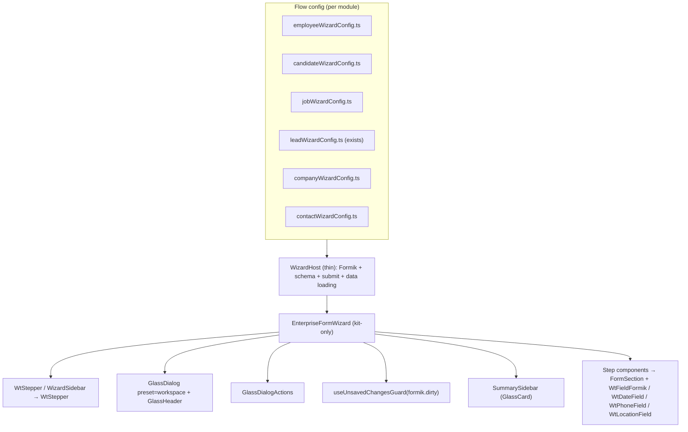
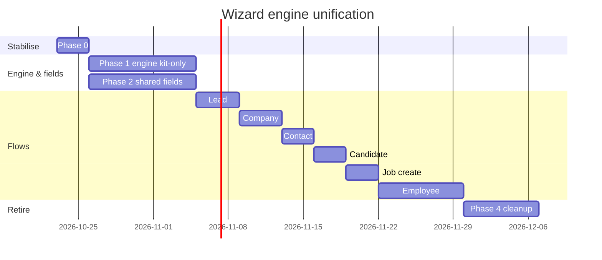

# One Wizard Engine: `EnterpriseFormWizard` App-wide Migration Plan

**Status:** Proposed · **Date:** 2026-10-22 · **Owner:** Frontend
**Decision:** `src/shared/form-engine` → **`EnterpriseFormWizard`** (config-driven) is the **single, globally shared wizard engine**. Every multi-step create/edit flow moves onto it; `OnboardingWizard` and hand-built monolith wizards are retired.
**Companions:** `docs/onboarding-wizard-kit-migration.md` (field/input layer detail) · `docs/bootstrap-to-kit-migration.md` · kit `src/app/modules/common/components/ui/README.md` · `AGENTS.md`

---

## 1. Why one engine

Today the app has **three** wizard implementations, each with its own stepper, footer, toasts, dirty handling, layout CSS and bugs:

| # | Engine | Flows on it | Kit status |
|---|---|---|---|
| A | **`EnterpriseFormWizard`** + `WizardSidebar` + `SummarySidebar` (`src/shared/form-engine`) | Lead workspace (beta), Company workspace, Contact workspace | ⚠️ Engine file in legacy baseline; 12 Bootstrap classes, 7 hex, direct `react-toastify`; `moduleIcon` is a Bootstrap-icon class |
| B | `OnboardingWizard` + `FullscreenWizardModal` (`pages/employee/forms/onboarding`) | Employee create/edit, Candidate, Job create | ⚠️ Legacy baseline; `react-toastify`, 7 hex; shell uses `UnsavedChangesModal` compat wrapper + Metronic `KTIcon` |
| C | Hand-built monoliths | `LeadWizardModal` (~3.4k lines), `NewCompanyForm` (~1.9k), `ClientContactsForm` (~1.2k) | ❌ `react-bootstrap`, raw `react-select`, legacy `DropdownInput`/`TextInput`, up to 48 Bootstrap classes |
| — | Metronic demo (`src/app/modules/wizards`, route `crafted/pages/wizards/*`) | none (template) | Dead code → delete |

Also unused: the kit's **`WtStepper`** (`ui/stepper.tsx`), whose own header says it was built to replace every wizard's hand-rolled stepper.

**Why A wins:** it is already config-driven (`EnterpriseWizardStep[]`, `WizardSummaryConfig`, `WizardActionConfig`), already hosts 3 flows, already has shared hooks (`useAddressCascade`, `useCompanyHierarchy`, `usePrefixGeneration`), and steps are just `component`/`render` + `requiredFields`, which is exactly what B's hand-built groups and C's monoliths need to become.

---

## 2. Goal (SMART)

| | |
|---|---|
| **Specific** | All 7 wizard flows (Employee, Candidate, Job, Lead, Company, Contact, Lead legacy-migration/bulk-import where multi-step) render through `EnterpriseFormWizard`; the engine itself is 100% kit (`WtStepper`, `GlassDialog`, `GlassDialogActions`, `FormSection`, kit `toast`, `useUnsavedChangesGuard`, `WtField*`). |
| **Measurable** | 0 imports of `OnboardingWizard`, `FullscreenWizardModal`, `UnsavedChangesModal`, `react-bootstrap`, raw `react-select`, legacy inputs in any wizard file; engine + all wizard files removed from `.eslint-ui-baseline.cjs`; E2E create+edit green for all 7 flows. |
| **Achievable** | Engine first (1 component tree), then flows one PR each; old UI kept behind a flag until parity. |
| **Relevant** | One place to fix steppers, dirty-exit prompts, validation navigation, a11y, dark mode, mobile, and the CJS-interop class of prod crashes. |
| **Time-bound** | ~10 weeks (5 sprints), see §8. |

---

## 3. Target architecture



### 3.1 Engine contract (additions to `formEngine.types.ts`)
Keep the existing API; add only what B and C need:

| Add | Why |
|---|---|
| `presentation: 'modal' \| 'page'` | Employee/Candidate/Job open fullscreen; Leads/Company embed in a page |
| `icon?: AppIconName` (deprecate `moduleIcon` Bootstrap class) | Kit icons, no Bootstrap icon font |
| `validateStep?: (values) => Promise<FormikErrors>` or Yup schema per step | B/C validate per step today |
| `onExitRequest?` handled internally by `useUnsavedChangesGuard` | One dirty-exit behaviour everywhere |
| `layout: 'sections' \| 'steps'` | B is accordion-sections, C is linear steps; both map to `EnterpriseWizardStep` |
| `persistDraft?: { key: string }` (optional) | Long forms (employee, lead) |
| `telemetry?: { stepId }` tagging for `/api/client-error` | Attribute crashes to a step |

**Rule:** features never import `WizardSidebar`/`SummarySidebar` directly; they pass config. Engine stays generic (no module-specific code). Module-specific hooks live next to the config.

---

## 4. Inventory & mapping

| Flow | Current host / engine | Target config | Notes / risks |
|---|---|---|---|
| Employee create/edit | `NewEmployeeWizard` (2.2k) → B | `employeeWizardConfig.ts` | Biggest; 21 step forms on legacy inputs (see onboarding doc). Phone #130 fix first |
| Candidate | `CandidateWizardHost` + `buildCandidateWizardGroups` → B | `candidateWizardConfig.ts` | Host is clean; groups map almost 1:1 to steps |
| Job create | `JobCreateWizardHost` + `buildJobCreateWizardGroups` → B | `jobWizardConfig.ts` | Remove `@metronic` import |
| Lead | `LeadWizardModal` (3.4k, C) with opt-in `LeadWorkspace` (A) | `leadWizardConfig.ts` (exists in `src/modules/leads/configs`) | Finish parity, flip default, delete legacy body |
| Company | `NewCompanyForm` (1.9k, C) mounting `CompanyWorkspace` (A) | `companyWizardConfig.ts` | Used from Leads, Contacts, Projects, Overview: keep a stable `<CompanyWizard>` entry API |
| Contact | `ClientContactsForm` (1.2k, C) mounting `ContactWorkspace` (A) | `contactWizardConfig.ts` | Google-contacts prefill path must survive |
| Lead legacy migration / bulk import | `LegacyMigrationWizard`, `LeadBulkImport` | Evaluate; likely **not** form wizards (import flows): kit chrome only | Remove `react-bootstrap`, `@metronic` |
| Roles & permissions | `RolesAndPermissions`, `RoleAccessEditor` | **Not a wizard**: kit chrome cleanup only | 13 BS classes, 6 hex, direct toastify |
| Metronic demo | `modules/wizards/*` | **Delete** + route `crafted/pages/wizards/*` | Dead template |

---

## 5. Phased plan

### Phase 0: Stabilise & freeze (days 1–3)
- [ ] Hotfix `react-phone-input-2` CJS default (`resolveReactComponent`) in `components/PhoneNumberInput.tsx` + `modules/common/inputs/PhoneInput.tsx`.
- [ ] CI smoke: `vite build` → preview → open each wizard route (prod-only interop crashes).
- [ ] Amplify SPA rewrite so deep links (`/employees/create-new`) don't 404.
- [ ] **Freeze:** ESLint `no-restricted-imports` on `OnboardingWizard`, `FullscreenWizardModal`, `UnsavedChangesModal` for *new* files (ratchet existing).
- [ ] Delete Metronic demo wizard + route.

### Phase 1: Harden the engine to kit-only (weeks 1–2)
- [ ] `WizardSidebar` step rail → **`WtStepper`** (vertical desktop; compact "Step n of N" on mobile, which is built in).
- [ ] Shell → `GlassDialog` (`preset="workspace"`) / page variant via `presentation`.
- [ ] Footer → `GlassDialogActions` (navy primary, white ghost Cancel).
- [ ] `react-toastify` → kit `toast`; hex → theme tokens / `toneSurface`; Bootstrap classes → `FormSection` + MUI `Grid`/`Stack`.
- [ ] `moduleIcon` (Bootstrap class) → `icon` (`AppIcon`), with a deprecation shim.
- [ ] **`useUnsavedChangesGuard`** wired into engine: Cancel / X / Esc / backdrop / Back / reload.
- [ ] Per-step validation + "jump to first error step" + `WtStepper` `error` state.
- [ ] a11y: focus first field on step change, `aria-current="step"`, announce errors.
- [ ] Remove engine files from `.eslint-ui-baseline.cjs`.
- [ ] Engine tests: navigation, required-field gating, dirty guard, submit, error jump.
- **Exit:** Lead/Company/Contact workspaces (already on A) look and behave correctly with the hardened engine, in light/dark and mobile.

### Phase 2: Shared field layer (weeks 2–3, parallel with Phase 1)
From the onboarding plan, done once for every flow:
- [ ] `TextInput` → `WtFieldFormik`; `RadioInput` → `SegmentedControl`/`WtField`; `MonthYearInput` → `WtDateField`; `DropdownInput` → `WtFieldFormik searchable addOption` (adapters first, then direct use).
- [ ] New kit primitives: **`WtPhoneField`** (ESM-safe), **`WtLocationField`** (from `SmartLocationPicker`).
- [ ] `ApprovalSettings` off raw `react-select`.

### Phase 3: Move flows onto the engine (weeks 4–8)
One PR per flow, each behind a flag (`wizardEngine.<module>`), old path kept until parity sign-off.

| Order | Flow | Why this order |
|---|---|---|
| 1 | **Lead** (flip `LeadWorkspace` to default; delete legacy body of `LeadWizardModal`) | Already on A; largest legacy file removed |
| 2 | **Company** (`CompanyWorkspace` default; shrink `NewCompanyForm` to a thin host) | Already on A; reused by Leads/Contacts/Projects |
| 3 | **Contact** (`ContactWorkspace` default; keep Google prefill) | Already on A |
| 4 | **Candidate** (`buildCandidateWizardGroups` → `candidateWizardConfig`) | Clean host; small |
| 5 | **Job create** | Clean host; small |
| 6 | **Employee** (`NewEmployeeWizard` → host + `employeeWizardConfig`; split 2.2k lines into config, schema, submit hook, initial-values hook) | Largest; benefits from everything above |

Per-flow checklist:
- [ ] Config file: steps (`id`, `title`, `requiredFields`, `component`), summary rows, actions.
- [ ] Host only owns Formik, schema, data loading, submit; no layout.
- [ ] Payload snapshot test before/after (no API change).
- [ ] QA matrix (§6) green; flag on in staging 1 week; then default on.

### Phase 4: Retire & clean (weeks 9–10)
- [ ] Delete `OnboardingWizard`, `FullscreenWizardModal`, `OnboardingModal.css`, `crmWizardTheme.css`, `Workspace.css` leftovers once unused.
- [ ] Delete legacy bodies of `LeadWizardModal`, `NewCompanyForm`, `ClientContactsForm` (keep thin exported wrappers if many call sites).
- [ ] Remove `UnsavedChangesModal` compat wrapper when no Bootstrap forms remain.
- [ ] Remove flags; update kit README ("Wizards → `EnterpriseFormWizard` only") and `docs/bootstrap-to-kit-migration.md` §3.4.
- [ ] Roles & permissions chrome cleanup (non-wizard, separate PR).

---

## 6. QA matrix (every flow)

| Check | Create | Edit |
|---|---|---|
| Happy path submit | ✔ | ✔ |
| Required-field gating; click-ahead blocked | ✔ | ✔ |
| Submit with errors jumps to first error step | ✔ | ✔ |
| Dirty → Cancel / X / Esc / Back / reload prompts; clean closes silently | ✔ | ✔ |
| Nested create (e.g. Company from Lead, Contact from Company) returns value to parent | ✔ | ✔ |
| Phone / location / date / multi-select with "+ Add" | ✔ | ✔ |
| Light/dark · glass/material | ✔ | ✔ |
| 360px mobile (compact stepper) · iOS Safari · desktop | ✔ | ✔ |
| Prod build (`vite build && vite preview`) | ✔ | ✔ |
| Payload identical to legacy (snapshot) | ✔ | ✔ |

---

## 7. 360° checklist

| Dimension | Standard |
|---|---|
| Design system | Kit-only; tokens; no hex, Bootstrap or Metronic in engine/flows |
| UX | Same steps and labels per flow; consistent footer; summary sidebar on desktop, collapsible on mobile |
| Unsaved changes | Engine-level guard; no per-flow implementations |
| Validation | Per-step Yup; error step highlighted in `WtStepper` |
| Accessibility | Focus management, `aria-current`, labelled fields, keyboard nav, axe 0 serious |
| Performance | Steps lazy-loaded (`component` via `lazy`); heavy deps (map, photo editor) per-step chunks |
| Build safety | No default-imported CJS UI libs without `resolveReactComponent`; prod-build smoke in CI |
| Observability | Client-error reports tagged with `module` + `stepId` |
| Testing | Engine unit tests; per-flow RTL + payload snapshots; E2E create/edit |
| Rollout | Per-flow flags; staging soak; one-sprint fallback |
| Docs | Kit README + this doc + migration doc updated; "how to add a wizard" section |

---

## 8. Timeline



---

## 9. Risks & mitigations

| Risk | Mitigation |
|---|---|
| Engine becomes a god-component as flows add special cases | Extension points only via config/hooks; no `if (module === 'x')` in engine; review rule |
| Behaviour drift vs. legacy (cascades, prefill, nested create) | Payload snapshots + per-flow flags + staging soak |
| `NewCompanyForm`/`ClientContactsForm` are imported from Leads, Projects, Overview | Keep a stable wrapper API; swap internals only |
| Prod-only CJS interop crashes | CI prod-build smoke on every wizard route |
| Long migration stalls halfway (two engines forever) | Phase 0 import freeze + baseline ratchet + Phase 4 deletion as DoD |
| Large files cause merge pain | Land engine first; split `NewEmployeeWizard`/`LeadWizardModal` early in their PRs |

---

## 10. Progress audit

```bash
# other engines / shells still referenced
rg -l "OnboardingWizard|FullscreenWizardModal|UnsavedChangesModal|modules/wizards" src
# legacy in wizard engine + flows
rg -n "from ['\"](react-bootstrap|react-toastify|react-select|react-phone-input-2)|@metronic/|inputs/(TextInput|RadioInput|DropdownInput|MonthYearInput)" \
  src/shared/form-engine src/app/pages/employee/{wizard,forms,recruitment,leads/lead} \
  src/app/pages/employee/companies/{forms,companies/components,contacts/components}
# baseline ratchet
rg -n "form-engine|employee/(wizard|forms|recruitment)|leads/lead|companies/(forms|companies/components|contacts/components)" .eslint-ui-baseline.cjs
```
**Done when** all three return nothing and §6 is green for every flow.

---

## 11. How to add a new wizard (after migration)
1. Create `src/modules/<module>/configs/<module>WizardConfig.ts` with `EnterpriseWizardStep[]`, summary, actions.
2. Build steps from `FormSection` + `WtFieldFormik`/`WtDateField`/`WtPhoneField`/`WtLocationField`.
3. Thin host: Formik + Yup schema + submit; render `<EnterpriseFormWizard {...config} />`.
4. Never import a stepper, dialog shell, footer or dirty guard yourself; the engine owns them.
